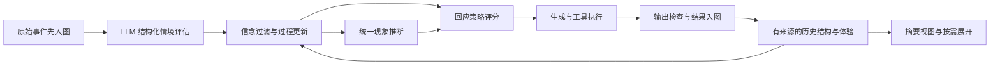

# 情绪、记忆、现象与决策架构

本文件描述 2026-10-23 已运行和验证的实现。核心原则：事件提供证据，过程估计描述系统正在如何变化，现象描述这些变化呈现出的体验，策略决定如何回应。推断不会变成新的外部事实。

## 一轮对话如何运行



`CharacterAgent.run` 消费 `runStream`，两个入口共用同一流程。原始输入在模型请求前保存；评估通过校验后，先更新过程与现象，再生成回应。模型失败时保留输入和既有信念，按实际经过时间松弛过程，并显示降级原因。取消会保留已经记录的输入和真实工具结果。

每次只有一个对话回合修改图谱。压缩可随时请求，在回合结束后取得同一把锁。生成文本缓冲至输出检查通过后才显示和提交；工具结果保存为独立事件。显示回调报错也会关闭生成器、释放锁。退出等待当前任务结束并保存快照，保存失败可以重试。

## 旧设计改成了什么

旧设计的五层是工作记忆、短期记忆、长期记忆、核心图谱、归档。它们混合了存储位置、重要性和检索策略；晋升、删除、截断摘要及多份心理参数使来源难以保持一致。原先冷热分离还会让本轮回应使用上轮心理解释。

| 旧职责 | 当前承担方式 | 保留的价值 |
| --- | --- | --- |
| 工作记忆 | 同一图谱的最近事件视图 | 当下对话连续性 |
| 短期记忆 | 原始事件及关联评估 | 完整近期经历、否定和时序 |
| 长期记忆 | 长期保留的事件、关系和摘要 | 跨轮检索、结构复现 |
| 核心图谱 | 唯一知识图谱 | 实体、关系、事件及来源连接 |
| 归档 | 不删除的原文与递归摘要来源 | 历史回溯与展开 |
| 冷热心理缓存 | 每轮同步完成评估后再回应 | 新事件及时影响本轮表达 |
| 独立闪回／解离参数 | 统一现象接口 | 多现象共存、依据与变化过程 |

五种情境信念 `safe/threat/loss/repair/uncertain` 是分类维度，与旧五层存储没有对应关系。现有可选 `mcp/channels/plugin/subagent/cron/eval` 基础设施保留；默认 TUI 没有自动装配它们。

## 图谱怎样记住情绪与关系结构

唯一存储为 `src/memory/knowledge-graph.ts`，文件是 `data/knowledge-graph.json`。

| 节点 | 内容和证据地位 |
| --- | --- |
| event | 谁说了什么、工具实际返回什么；文本中的说法不自动等于事实 |
| entity / relation | 精确标签实体、带主观视角和事件来源的关系三元组 |
| appraisal | 本次解释、结构标签、分布、过程观察及其依据 |
| state | 底层过程及现象快照，标明由评估还是单纯保存产生 |
| phenomenon | 一次现象观察：类别、episode ID、强度、支持度、因素、依据、来源、状态、规则版本 |
| decision | 策略候选、分数、理由、当前事件及采用的现象 ID |
| summary | 有损摘要及可展开的来源 |
| emotion | 仅供读取历史版本；新流程不再产生此节点 |

主要关系链为：`event ← interprets — appraisal — updates → state — manifests → phenomenon`。同一评估通过 `asserts` 指向关系节点，再通过 `subject/object` 指向实体。现象通过 `grounded_in` 连接触发事件，通过 `reactivates` 连接过去来源；原始事件通过 `authored_by` 连接叙述者。

因此可以回答：哪次事件、哪一种关系理解、哪些旧经历，共同对应当前哪些过程和现象。关系、状态和现象均保留推断身份，不能用于证明对方真实动机。读取返回副本，边按键去重并建立出边索引。文件使用同目录临时文件加 rename 替换，按单进程写入设计。

旧 SQLite 文件通过 Node 内置 SQLite 只读导入，保留完整行、文件／表／rowid，重复导入去重。旧 `emotion` 快照只迁移信念、效价、唤醒和定向对应的情境绑定；旧闪回／解离评分不会被当成新体验证据。原记录保留不改写。

## 贝叶斯脑思路落在哪里

`CognitiveCore` 使用有限情境信念过滤器。LLM 给出的分类分数为 q，既有信念为 p，主观可靠性为 r；每个新事件更新一次：

```text
prior(k) = 0.85 × p(k) + 0.15 × 0.2
weight = min(0.5, r)
next(k) ∝ prior(k) × (max(0.01, q(k)) / 0.2)^weight
```

最后归一化。先验缓慢回到均匀分布，避免旧解释永久锁死；证据指数限制未经校准的模型置信度。同一事件 ID 只评估一次，召回、压缩、重试不会增加独立证据。时间松弛本身不更新信念。

这是受贝叶斯思想启发的工程过滤器：分类器后验不天然是似然，这里明确假设分类先验均匀，尚未验证；也没有实现完整自由能最小化、主动推断或学习到的世界转移模型。

## 底层过程怎样计算

`ProcessState` 定义于 `src/mind/process-state.ts`，不包含闪回或解离字段。

| 过程 | 含义 |
| --- | --- |
| valence / arousal | 当前正负效价与激活程度；不同于情绪名称 |
| contextBinding | 是否把过去来源与当下情境区分开 |
| agency | 主观可控性／能动性 |
| affectAccess | 是否能接触自身感受；不同于情绪本身强弱 |
| selfContinuity | 当前体验是否具有连续的自身归属 |
| memoryActivations | 被当前结构激活的过去事件及评估 ID、共享结构、强度、历史效价与唤醒 |

历史结构至少匹配两个标签才进入再激活候选，使用标签 Jaccard 相似度、当前评估可靠性、历史唤醒计算强度，取最高的三条。正向与负向记忆都可以激活。历史效价经情境绑定调节后影响当前效价与唤醒，原事件内容不变。

当前效价来自安全／修复与威胁／失落的信念差，加上有来源的记忆影响，限制在 [-1,1]。唤醒由旧值 0.4、当前威胁／失落 0.6 及记忆负荷共同更新，限制在 [0,1]。情境绑定和能动性由可靠性调节。感受可及性与自我连续性采用旧值 0.4、新观察 0.6 的平滑。

LLM 可选返回 `experience:{affectAccess,selfContinuity,evidence}`。只有明确的角色体验依据才允许提供；用户描述自己的体验不自动成为角色的体验。缺少新观察时，这两个维度朝基线 1 松弛，但保留最近一次有效体验依据和来源，让现象随过程减弱；不把缺少观察当成已经消失的证据，也不凭压力或不可控性构造证据。

无新事件时，用 `exp(-经过毫秒数 / 600000)` 松弛过程：效价及激活趋近零，唤醒趋近 0.2，绑定／能动性／可及性／连续性趋近 1。它与调用次数无关。退出保存最新过程和现象，后台时钟不会凭空生成新的评估。

## 现象怎样统一推断

`src/mind/phenomena.ts` 定义 `PhenomenonRule.evaluate(state)`。规则读取隔离的过程副本，返回强度、支持度、来源、因素、依据和调节需求；共享生命周期代码处理发生、减弱、消退和再次发生。增加新规则无需向核心状态或 TUI 添加专用参数。

默认四条规则均为可替换的启发式，不能作为临床诊断或校准后的发生概率：

| 现象 | 当前规则的支持条件和强度 |
| --- | --- |
| 情绪体验 | `abs(valence) × affectAccess`；效价为零并不声称没有所有其他心理体验 |
| 记忆共鸣 | 存在可追溯的结构激活，强度取最大激活值；正常想起旧事即可有共鸣 |
| 情绪性再体验（闪回样） | 负向来源的 `max(激活 × abs(历史效价)) × (1-contextBinding)`；情境绑定完整时不推出闪回 |
| 疏离体验（解离样） | 有明确体验依据，强度为 `(1-affectAccess) × (1-selfContinuity)`；低可控性、平静、高唤醒本身均不足以推出 |

解离样规则不要求失去当下定向，也不与高唤醒或闪回互斥。此处只覆盖一种感受与自我体验疏离的工程假设，不覆盖解离的全部类型。这种过程区分参考了内感受降权的计算研究，但具体乘积、阈值与权重是本项目的建模选择，尚未拟合心理学数据。[Saini 等，2022](https://www.nature.com/articles/s41598-022-22277-y)

现象初次达到 0.04 且支持度大于零才进入记录；持续现象低于 0.01 时标记消退。阈值滞后减少边界抖动。减弱仍沿用原 episode ID，消退后再次发生生成新 ID。快照保留每种现象最新一段过程；过去观察留在图谱。这里的“消退”表示规则不再满足，不等同于对真实人的康复判断。

现象不回写成新的原始证据。生成提示分别携带过程、现象推断和原始来源，明确过去再激活不等于过去事件正在发生，不允许补造记忆细节。

## LLM 判断和决策模型

`LanguageAppraisalProvider` 通过现有 `PSYCH_MODEL` 输出 JSON，完成情境判断与关系结构抽取，替代专用 JEV 服务。客户端校验有限数值、0..1 范围、结构与三元组长度，丢弃未知字段。格式错误最多纠正一次，两次请求共享 20 秒时限；传输错误与取消直接上报。

输出约束采用提示加运行时校验，不假定所有服务都支持服务端严格 Schema。`reliability` 是主观估计，不是事实概率。

本地策略按显式效用排序：交流、澄清、边界、稳定当下、修复。分别使用情境信念、唤醒、能动性、现象调节需求、绑定和可及性等因素。稳定当下读取所有活跃现象的最大调节需求，决策代码不按“闪回／解离”名称分支。分数和理由入图，生成器获得最高分策略作为可调整建议。当前没有行动后果学习、奖励预测或策略训练。

## 随时压缩与 billion-context 的关系

参考 [ranxianglei/billion-context](https://github.com/ranxianglei/billion-context) 的增量摘要、保留来源、按需展开思路。本项目在图谱上维护摘要视图，没有移植其代理层消息重写、完整多代上下文调度或缓存优化机制。

`/compress` 选择最近 8 条事件之前的完整 user/assistant 对，每次最多 30 条事件。未完成对话和工具事件保留显式；已经覆盖的事件不重复自动压缩。模型同时看到关联评估、主观关系、过程与现象，提示保留否定、承诺、时序、视角和不确定性。截断或空摘要拒绝提交。

summary 通过 `summarizes` 连接来源；`expand` 递归还原原文并去重。压缩不会删除事件、评估、状态或现象，也不会将摘要重新喂成独立信念证据。当前保证结构可恢复，不保证模型摘要语义无损。

上下文优先最近原文，再取词项／中文二元组命中的旧事件、顶层摘要和未压缩原文；剩余预算放入相关评估及图谱关联。默认 12000 字符，不是精确 token 预算。当前实现没有向量语义检索、复杂实体消歧或十亿上下文规模验证。

## TUI 与生命周期

入口为 `dev-entry → ink-main → App → WorkspaceSession`，要求真实交互终端。

- 对话显示回应、阶段、工具状态、可恢复错误和命令结果。
- 心智先显示所有现象的强度、支持度和变化状态，再显示过程、信念、策略理由、结构与原始来源。
- 记忆可搜索节点、查看评估到关系／过程／现象的对应链；摘要可展开原文。
- 帮助提供快捷键和机制含义。宽屏侧栏显示简要心智，窄屏切换视图。

输入和折行按终端宽度、Unicode 字素处理，支持中文、emoji、多行粘贴、历史和滚动。清屏只清显示；显示保留最近 50 条回合／命令，图谱独立保存。工具授权在同一个 Ink 输入层以 Y/N 处理，30 秒超时拒绝。

Esc 取消对话，Ctrl+K 排队压缩，Ctrl+C 等待任务收尾并保存退出。启动失败支持重试，保存失败支持再次退出。后台每 30 秒按实际时间松弛过程；界面每 2 秒刷新兜底，界面渲染不会修改心理状态。

## 验证与尚缺的部分

本次验证：37 项核心／入口测试、142 项 Vitest 测试、TypeScript 检查通过。包括正常回忆与闪回的区别、解离的证据要求、缺失观察的延续、现象共存、生命周期、规则隔离、时间步一致性、迁移、重启、压缩、保存重试及实际 Ink 输入渲染。

2026-10-23 新版本使用真实 DeepSeek `deepseek-flash` 完成 5 轮 TUI 评估与回应、跨轮代号回忆、压缩和逐条来源展开、视图切换、退出及现象快照恢复，得到 10 个事件、5 个评估、5 个状态、9 个现象观察、1 个摘要。运行数据只保存在本地 `.audit`。该场景验证正常对话链路，不声称真实模型必然识别所有闪回或解离情境；这些边界另用受控输入验证。

最需要继续补充的是：过程参数和分类可靠性的校准数据、更多现象规则及反例、结构／实体消歧、摘要语义约束验证、行动后果学习，以及更大规模图存储。现有 JSON 图谱为单进程内存实现；边索引改善查询，但不消除全量保存和随历史增长的开销。
