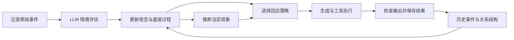

# Character Mind

用知识图谱连接经历、关系、情绪体验与回应的角色心智系统。

Character Mind 的重点是：一件事如何被角色理解，哪些旧经历被激活，这些过程呈现出什么现象，以及它们怎样影响当下回应。每一步都保留来源，可以在终端中查看、追溯和展开。

项目使用 TypeScript、React 与 Ink，默认通过 DeepSeek 完成结构化情境评估和语言生成。当前版本已统一记忆与认知流程，移除了冷热心理缓存、五层记忆晋升及重复心理参数。

## 快速开始

需要 Node.js **24 或更新版本**、npm 和交互式终端。文件搜索工具还需要安装 [ripgrep](https://github.com/BurntSushi/ripgrep)。

```sh
git clone https://github.com/X3evendren/character_mind.git
cd character_mind
npm ci
```

PowerShell：

```powershell
$env:DEEPSEEK_API_KEY = '你的 API 密钥'
npm start
```

macOS / Linux：

```sh
export DEEPSEEK_API_KEY='你的 API 密钥'
npm start
```

启动后直接输入消息。按 **Tab** 切换视图，按 **Ctrl+C** 保存并退出。`npm run dev` 使用相同入口。请在终端中运行，入口不支持将标准输入重定向为文件或管道。

密钥从进程环境或程序调用参数读取，不自动加载 `.env`。密钥、记忆数据和运行日志不应提交到 Git。

## 一轮对话的完整过程



输入先保存，再请求模型。通过校验的评估会在**本轮生成前**更新角色状态。评估失败时，输入仍然保留，界面显示原因，回应沿用既有信念；取消不会撤销已经保存的输入或真实工具结果。

原始事件、角色解释、过程估计和现象推断分别保存。角色认为对方在疏远自己，不等于系统确认了对方的真实动机。

## 过程与现象

底层过程描述系统如何变化；现象描述这些过程呈现出的体验。闪回和解离通过统一现象接口推断，不再作为独立累加的心理参数。

底层维护：

- **情境信念**：安全、威胁、失落、修复、不确定性。
- **效价与唤醒**：体验的正负方向和激活程度。
- **情境绑定与能动性**：过去／当下的区分，以及主观可控性。
- **感受可及性与自我连续性**：能否接触自身感受，体验是否保持连续的自身归属。
- **记忆激活**：当前关系结构激活了哪些过去事件，以及它们的来源和历史状态。

所有现象共享强度、支持度、依据、来源、规则版本和生命周期：发生 → 减弱 → 消退；再次发生会创建新的 episode ID。

| 默认现象 | 支持条件 | 避免的误判 |
| --- | --- | --- |
| 情绪体验 | 效价与感受可及性共同形成的体验读数 | 将感受可及性等同于情绪强度 |
| 记忆共鸣 | 当前结构激活有来源的旧事件 | 将正常回忆自动判作闪回 |
| 情绪性再体验（闪回样） | 负向过去记忆被激活，同时过去与当下的情境绑定减弱 | 将过去事件说成正在发生 |
| 疏离体验（解离样） | 有明确体验依据，感受可及性与自我连续性共同降低 | 仅凭不可控、高压力或平静推出解离 |

现象可以共存。解离样疏离不要求失去当下定向，也可以与高唤醒同时出现。缺少新的体验观察时，系统保留最近有效依据，让现象随过程逐渐减弱。

这些是**尚未校准的计算规则**，用于角色模拟，不用于诊断使用者，也不覆盖所有闪回或解离类型。强度和支持度不能当作临床发生概率。

## 贝叶斯思路与决策

信念更新结合既有判断与新评估，对模型自报可靠性降权，再归一化。每个原始事件只计入一次；召回、压缩和重试不会被当成新的独立证据。无新事件时，过程按真实经过时间松弛，计时器不会生成新的心理证据。

这是一种受贝叶斯思想启发的有限状态过滤器，尚未实现完整主动推断或自由能最小化。具体公式和假设见 [架构说明](./ARCHITECTURE.md#贝叶斯脑思路落在哪里)。

情境判断使用现有 LLM 返回结构化 JSON，无需单独接入 JEV 服务。客户端校验字段和数值，格式错误最多纠正一次，两次请求共用 20 秒时限。

回应策略包括交流、澄清、设立边界、稳定当下和关系修复。策略读取信念、过程和现象调节需求，记录候选分数与理由；当前采用显式启发式效用，尚未实现行动后果学习。

## 一张知识图谱与随时压缩

记忆保存在 `data/knowledge-graph.json`。事件、实体、关系、评估、过程、现象、决策和摘要都属于同一张图谱。

```text
原始事件 ← 解释关系 — 主观评估 — 更新关系 → 过程快照 — 呈现关系 → 现象
                         └── 主观关系三元组                  └── 触发事件与过去来源
```

这样可以追溯“哪次事件、哪一种关系理解、哪些旧经历，对应现在的什么体验”。旧版本的 `emotion` 节点保留为历史记录，新流程不再产生它。

按 **Ctrl+K** 或输入 `/compress` 即可请求压缩。系统会：

1. 等待当前回合结束，在稳定边界修改摘要视图。
2. 选取较早的完整对话对，每次最多 30 条事件；最近 8 条事件、未完成回合和工具结果保持显式。
3. 将关联评估、关系、过程和现象一并交给摘要模型。
4. 创建带来源的摘要节点，保留全部原始事件及心理关联。

用 `/expand <节点ID>` 或在记忆视图中打开摘要，可以展开保留的原文。摘要有损，**来源可恢复不代表摘要语义无损**。

压缩设计参考 [ranxianglei/billion-context](https://github.com/ranxianglei/billion-context) 的增量摘要、来源保留和按需展开思路；当前项目没有移植其完整代理层调度与缓存机制，也未验证十亿上下文规模。

如果数据目录中存在旧 `stm.db`、`ltm.db`、`archive.db` 或 `core.db`，启动时会只读导入记录并去重，旧文件保留。旧心理评分不会直接升级为新现象的证据。

## 终端工作台

| 视图 | 可以查看和操作的内容 |
| --- | --- |
| 对话 | 输入、回应、执行阶段、工具状态、错误和命令结果 |
| 心智 | 当前现象、底层过程、信念、策略理由、结构标签和来源 |
| 记忆 | 搜索图谱节点，查看心理与关系对应链，展开摘要原文 |
| 帮助 | 可用命令、快捷键与读数含义 |

支持中文、emoji、组合字符、多行粘贴、输入历史、滚动和窗口缩放。宽屏显示心智侧栏，窄屏可切换视图；最低终端尺寸为 36×12。

| 操作 | 快捷键或命令 |
| --- | --- |
| 切换视图 | Tab / Shift+Tab，或 `/view chat`、`/view mind`、`/view memory`、`/view help` |
| 发送／换行 | Enter / Alt+Enter；粘贴多行文本会保留为草稿 |
| 补全命令 | 输入 `/命令前缀` 后按 Tab |
| 滚动正文 | PgUp / PgDn，或 Ctrl+↑ / Ctrl+↓ |
| 输入历史 | ↑ / ↓ |
| 查看心智／搜索图谱 | Ctrl+G / Ctrl+F |
| 筛选和搜索 | `/memory summary`、`/memory phenomenon`、`/search 关键词` |
| 查看节点详情 | 记忆视图空输入时 ↑↓ 选择，Enter 打开，Esc 返回 |
| 请求压缩／展开原文 | Ctrl+K 或 `/compress`；`/expand <节点ID>` |
| 取消当前对话 | Esc 或 `/stop` |
| 清空显示 | Ctrl+L 或 `/clear`；图谱仍然保留 |
| 查看状态／模型 | `/stats` / `/model` |
| 保存退出 | Ctrl+C 或 `/quit` |

显示区保留最近 50 条回合／命令，更早的事件仍可在图谱中查询。需要确认的工具在同一界面显示参数，以 Y/N 操作，超时或取消视为拒绝。启动失败可以 `/retry`；退出保存失败可以再次重试。

## 配置

| 环境变量 | 默认值 | 用途 |
| --- | --- | --- |
| `DEEPSEEK_API_KEY` | 无 | 模型服务密钥 |
| `DEEPSEEK_API_BASE` | `https://api.deepseek.com` | 服务地址，可配置兼容接口 |
| `GEN_MODEL` | `deepseek-flash` | 回应和摘要模型 |
| `PSYCH_MODEL` | 与生成模型相同 | 结构化情境评估模型 |
| `MEMORY_DB_DIR` | `./data` | 图谱和旧记忆导入目录 |

例如，将生成、评估和记忆目录分别配置：

```powershell
$env:GEN_MODEL = 'deepseek-flash'
$env:PSYCH_MODEL = 'deepseek-flash'
$env:MEMORY_DB_DIR = './data/my-character'
npm start
```

每个角色使用独立数据目录，当前存储按单进程写入设计。模型配置修改后重启生效。官方 DeepSeek 接口显式关闭思考模式，为结构化输出和回应保留预算；其他兼容服务不附加这一参数。

角色名称、核心驱动、人格与行为准则来自 [`config/assistant.md`](./config/assistant.md)。编辑对应段落后重启。人格文本约束表达；它不代表系统已实现自动学习、自主意识或后台反思。

## 验证

```sh
npm run typecheck
npm run test:cognition
npm test
npm run test:tui
```

`test:tui` 是完整 Vitest 测试中的界面子集，无需为常规回归重复执行。

2026-10-23，在 Windows / Node 24 的隔离目录重新执行 `npm ci` 后：

| 检查 | 结果 |
| --- | --- |
| TypeScript 类型检查 | 通过 |
| 认知与真实入口的受控提供者测试 | 37 项通过 |
| Vitest | 142 项通过，其中 TUI 14 项 |
| 源码导入与语法检查 | 121 个文件通过 |
| 真实 DeepSeek 联调 | 5 轮 TUI 评估与回应、跨轮回忆、压缩、来源展开、视图切换、退出和现象快照恢复通过 |

配置密钥后，可自行运行真实模型验证：

```sh
npm run test:live
```

此命令会调用模型并产生服务费用，使用独立测试记忆目录，结果写入 `.audit/live-smoke-result.json`。受控测试覆盖现象共存、来源、生命周期、迁移、时间步一致性、保存重试和错误恢复；真实联调验证正常使用链路。两者都不等同于心理学模型校准。

## 当前边界

- 图谱是单进程、内存驻留的 JSON 存储，尚无多进程协调和大规模存储验证。
- 检索使用词项与中文二元组；上下文预算按字符计算，尚无向量语义检索或精确 token 调度。
- 实体按精确标签匹配，复杂别名与多角色身份消歧尚未实现。
- 现象规则、信念可靠性和策略权重仍需数据校准；摘要语义需要独立评测。
- `mcp`、`channels`、`plugin`、`subagent`、`cron`、`eval` 是保留的可选基础设施，默认 TUI 未自动启用。

## 文档与代码导航

| 入口 | 内容 |
| --- | --- |
| [ARCHITECTURE.md](./ARCHITECTURE.md) | 全机制说明、计算假设、旧五层设计的替代关系与局限 |
| [PROJECT.md](./PROJECT.md) | 模块职责和源码导航 |
| [CONTEXT.md](./CONTEXT.md) | 领域概念与证据边界 |
| [SECURITY.md](./SECURITY.md) | 工具权限、数据和护栏限制 |
| [CHANGELOG.md](./CHANGELOG.md) | 重构与历史变更 |
| [`src/mind`](./src/mind) | 信念、过程、现象与决策 |
| [`src/memory`](./src/memory) | 知识图谱、检索、压缩与旧库导入 |
| [`src/ui`](./src/ui) | 四视图工作台与会话生命周期 |
