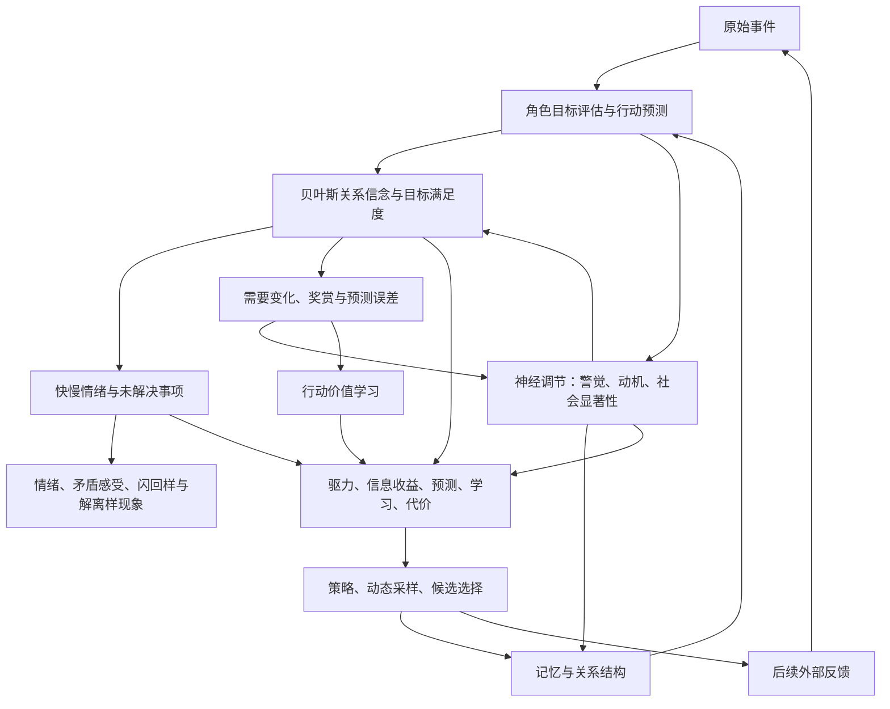

# Character Mind

一个用知识图谱、心理动力学与语言模型模拟角色情感和记忆的终端应用。默认角色是**林雨**：有自己的兴趣、感受、判断与边界，通过文字与你相处。

事件理解、目标需要、关系信念、情绪、神经调节、奖赏学习和行动选择组成同一条反馈回路。情绪会改变回应策略、生成参数与候选选择；后续交互又会改变先前行动的价值。角色可以主动延续有来源的话题。

这是计算模拟。参数尚未按人类数据校准，神经调节读数不是人体浓度，现象不是临床诊断。

## 启动

需要 Node.js **24+**、npm 和交互式终端。

```sh
git clone https://github.com/X3evendren/character_mind.git
cd character_mind
npm ci
```

PowerShell：

```powershell
$env:DEEPSEEK_API_KEY = '你的 API 密钥'
npm start
```

macOS / Linux：

```sh
export DEEPSEEK_API_KEY='你的 API 密钥'
npm start
```

直接输入消息，**Tab** 切换视图，**Ctrl+C** 保存退出。不自动读取 `.env`。默认数据目录为 `./data`；每个角色使用独立目录，同一目录只允许一个进程写入。

## 核心机制



| 机制 | 实际行为 |
| --- | --- |
| 事件与评估 | 通过输入检查的消息先保存。LLM 评估角色的联结、自主、胜任、真诚承诺和探索目标，并预测几种行动的后果；代码校验结构与值域。 |
| 贝叶斯关系信念 | 善意、可靠性、可获得性分别维护 Beta 分布。承诺低于已观察行为的权重；重复事件、回忆和时间流逝不增加证据。 |
| 快慢情绪 | 正负感受分别累积，可同时高兴与介意。默认快过程半衰期 15 分钟，慢心境 3 小时；具体未解决事项需明确修复。 |
| 神经调节 | 多巴胺通路类比连接预测误差、追求动机与行动价值；去甲肾上腺素通路类比调节警觉、注意、探索和学习；催产素通路类比调节社会线索权重。历史联结依赖具体关系证据。 |
| 记忆与现象 | 相似关系结构唤起旧体验。闪回样现象要求负向过去来源和弱情境绑定；解离样疏离还需明确体验依据。所有现象具有来源和生命周期。 |
| 决策与学习 | 比较交流、澄清、表达感受、分享喜悦、边界、定向、修复、探索、合作和等待。综合目标驱力、后果预测、信息收益、TD 学习与代价。 |
| 输出控制 | 动态调整 temperature、max_tokens、候选数量；情感显著的对话比较两份回应，按证据、感受、策略和自然度选择。只有最终文本进入角色事件。 |
| 主动性 | 空闲至少 90 秒、有具体动机、效用超过等待且通过冷却时，延续已有话题。每个来源最多一次，默认冷却 5 分钟。草稿、其他视图、任务或压缩会阻止主动发言。 |

自己生成的话、候选评分和被动时间流逝都不提供学习奖赏。输出克制也不会删除内部感受。完整公式、理论对应与计算顺序见 [动力学设计](./docs/dynamics.md)。

“苯乙胺→恋爱→去甲肾上腺素→多巴胺→催产素→依恋”没有被实现为确定因果链。本版本将奖赏、注意与社会关系放在共同回路中，未加入证据不足的苯乙胺“恋爱开关”。原始研究与映射边界见 [研究依据](./docs/literature-review.md)。

当前使用 API，没有修改模型权重、隐藏层或 logits；贝叶斯更新、二元信息收益和小型 TD 表也不等于完整大脑仿真或完整主动推断求解器。

## 一张图谱与随时压缩

`data/knowledge-graph.json` 保存事件、实体、关系、评估、过程、现象、决策、学习、生成控制和摘要，能够追溯“哪次经历、哪种理解，对应什么感受和行动”。

按 **Ctrl+K** 或 `/compress`，系统等待稳定回合边界，压缩较早的完整对话对，每次最多 30 条事件。最近 8 条事件、未完成回合、工具结果和主动发言保持显式；关联解释、情绪、关系、决策与学习会传给摘要模型。原始记录不删除，可用 `/expand <节点ID>` 展开。

参考 [ranxianglei/billion-context](https://github.com/ranxianglei/billion-context) 的摘要与来源展开思路。本项目没有移植其全部调度机制，也没有验证十亿上下文。压缩减少模型读取的上下文，不减少磁盘原始证据；摘要语义仍可能有损。

旧五层存储与冷热心理缓存已移除。旧 SQLite 只读导入；v2 状态迁移保留原始记录与兼容过程值，旧五类情境分数不会变成新关系信念或学习结果。现在使用 [`config/character.md`](./config/character.md)，旧 `assistant.md` 已移除。

## 终端工作台

| 视图 | 内容 |
| --- | --- |
| 对话 | 回应、主动表达、执行阶段、命令结果与错误 |
| 心智 | 正负感受、关系信念、需要、神经调节、奖赏误差、决策与生成控制 |
| 记忆 | 图谱搜索、节点详情、心理结构对应和摘要展开 |
| 帮助 | 命令、快捷键与数值含义 |

| 操作 | 快捷键或命令 |
| --- | --- |
| 切换视图 | Tab / Shift+Tab，`/view chat|mind|memory|help` |
| 发送 / 换行 | Enter / Alt+Enter；多行粘贴保留为草稿 |
| 滚动 / 输入历史 | PgUp / PgDn、Ctrl+↑ / Ctrl+↓；↑ / ↓ |
| 心智 / 搜索 | Ctrl+G / Ctrl+F、`/search 关键词` |
| 图谱筛选 | `/memory phenomenon`、`/memory learning`、`/memory control` |
| 查看详情 | 空输入时 ↑↓ 选择，Enter 打开，Esc 返回 |
| 压缩 / 展开 | Ctrl+K、`/compress`、`/expand <节点ID>` |
| 主动表达 | `/initiative on`、`/initiative off`、`/initiative status` |
| 取消 / 清屏 | Esc 或 `/stop`；Ctrl+L 或 `/clear` |
| 状态 / 模型 | `/stats`、`/model` |
| 保存退出 | Ctrl+C 或 `/quit` |

支持中文、emoji、多行输入和终端缩放，最小尺寸 36×12。显示保留最近 50 个回合，更早事件仍在图谱。开始输入会取消尚未提交的主动回应。启动失败可 `/retry`，保存失败可再次退出重试。主动性开关属于当前会话设置。

## 配置与费用

| 环境变量 | 默认值 | 用途 |
| --- | --- | --- |
| DEEPSEEK_API_KEY | 无 | API 密钥 |
| DEEPSEEK_API_BASE | https://api.deepseek.com | 服务地址 |
| GEN_MODEL | deepseek-flash | 生成、候选评分和摘要模型 |
| PSYCH_MODEL | 与生成模型相同 | 情境评估和行动预测 |
| MEMORY_DB_DIR | ./data | 独立角色记忆目录 |
| CHARACTER_TOOLS | 未开启 | 设为 1 注册旧工具集；仍有待修复审计问题 |

默认不注册文件、网络和命令工具。主动表达始终没有工具权限。旧工具审计的完整修复留作后续任务，见 [安全边界](./SECURITY.md)。

角色文本和数值参数均在 `config/character.md`，修改后重启。配置缺字段或参数越界会报错。DeepSeek 显式关闭 thinking，使温度调整可生效；其他兼容 API 的温度能力标记为未知。心智视图记录请求参数与提供者声明的支持范围，不能证明服务端逐项执行。

普通回合通常调用一次评估、一次生成；候选选择再增加一次生成和一次评分。格式纠正、工具续轮、压缩和主动表达会增加费用。界面 token 数汇总生成与候选调用中服务返回的 usage，尚未包含情境评估和摘要费用。

## 验证

```sh
npm run typecheck
npm run test:cognition
npm test
```

`npm run test:tui` 是完整 Vitest 中的界面子集。核心覆盖情绪、修复、神经调节耦合、反馈学习、预测与证据分离、主动性、候选选择、取消、来源、迁移和重启；TUI 使用实际 Ink 渲染与键盘输入测试。

真实模型验证需要密钥并产生费用，使用隔离的合成记忆：

```sh
npm run test:live
npm run test:live-affect
```

前者检查五轮 TUI、跨轮回忆、压缩、展开、退出与重启；后者检查亲近、受伤、道歉、修复与真实候选评估。报告保存在本地 `.audit`，个人对话和密钥不上传。运行通过不等于心理模型已经获得人类实验验证。

## 文档与边界

- [全机制与公式](./docs/dynamics.md) · [原始研究与实现映射](./docs/literature-review.md)
- [架构与迁移](./ARCHITECTURE.md) · [源码导航](./PROJECT.md) · [领域契约](./CONTEXT.md)
- [安全边界](./SECURITY.md) · [变更记录](./CHANGELOG.md) · [本次验收](./docs/verification.md)

当前仍是单进程内存图谱与同步 JSON 保存；检索使用词项与中文二元组，预算按字符计算。长期规模、关系身份消歧、摘要事实校验、人类数据拟合和跨模型校准仍需后续工作。保留的 MCP、渠道、插件、子代理与调度基础设施未默认装配。
